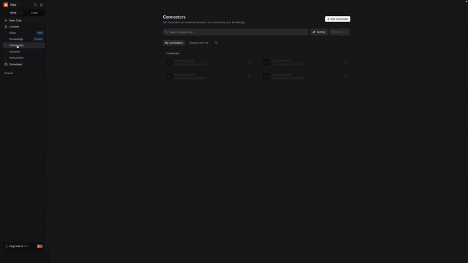

# Pass Through Entity Database

A read-only MCP endpoint for federal, state, and local pass-through entity tax documents.

## Links

- **Web search:** https://pass-through-entity-db.pages.dev/
- **MCP endpoint:** https://pass-through-entity-db.pages.dev/mcp
- **Document viewer:** [example document](https://pass-through-entity-db.pages.dev/doc/1); search results link to their own `/doc/<id>` page.

The public MCP endpoint requires no authentication.

## What it can do

- Search across 1,100+ official documents and 8,000+ pages covering 59 jurisdictions.
- Fetch a document's metadata and text, or request a specific PDF page.
- Browse documents by jurisdiction, area, document type, or title.
- Search and read 72 structured tables from CSV and XLSX sources.
- Run read-only SQL `SELECT`/`WITH` queries (up to 200 rows).
- Return database statistics.

Available MCP tools: `search`, `fetch`, `list_documents`, `get_document`, `list_datasets`, `get_dataset`, `search_tables`, `query_sql`, and `stats`.

## Connect with Mistral

  

### Video walkthrough

[Watch the full recording](mistral-walkthrough.mp4) — 3:04, no audio. The GIF preview is sped up 6× and skips some loading.

### Setup steps

1. Sign in at [chat.mistral.ai](https://chat.mistral.ai). If you start from mistral.ai, open the top menu and choose **Vibe**.
2. In the left sidebar, select **Context**, then **Connectors**.
3. Select **+ Add connector**.
4. Select **Add a custom connector** (some versions label this **Custom MCP Connector**).
5. In **Server URL**, enter `https://pass-through-entity-db.pages.dev/mcp`.
6. In **Connector name**, enter a unique name with no spaces or special characters, for example `pass-through-entity-db`.
7. Mistral should detect **No authentication** automatically. If prompted, choose **No authentication**.
8. Select **Add connector** (labeled **Connect** in some versions).
9. On the connector page, select **Try now**, or start a new chat.
10. Confirm the connector appears. If it is not used automatically, open **+ → Tools** and enable it.
11. Toggle **Fast** or **Think** (shown as **Thinking** in some versions), then ask your question.

> **Admin note:** Custom connectors are an administrator feature. On Free, Pro, and Student plans, the account owner is the administrator by default. On Team and Enterprise plans, an administrator must add the connector.

> **Troubleshooting:** If Mistral reports “MCP connection requires additional information or is invalid,” confirm the URL is exactly `https://pass-through-entity-db.pages.dev/mcp` with no trailing slash.

## Notes

- All tools are read-only. There is no write, update, or delete access.
- Search results include citations and links to public document pages.
- The public endpoint may be rate-limited.
- Tax information should be verified against the official source documents.

## Disclaimer

This project is provided for educational and informational purposes only. It is not tax, legal, or accounting advice. Use at your own risk. The author assumes no responsibility or liability for any errors, omissions, or outcomes resulting from use of this service or its data. Always verify information against official source documents and consult a qualified professional.
